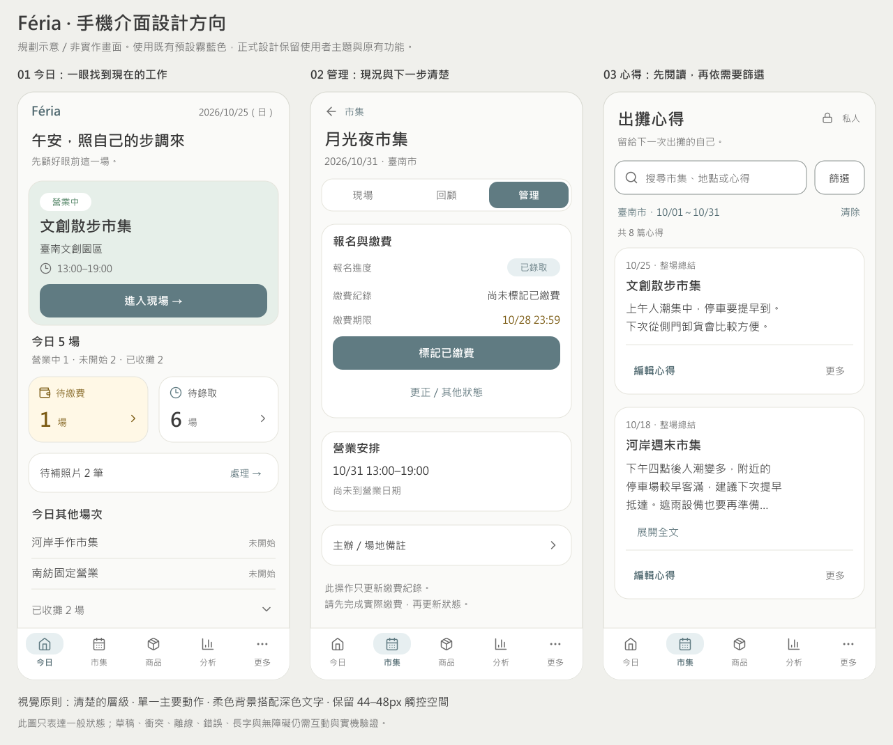

# UI／UX 優化計畫二次審查：合理性、收益與取捨

日期：2026-10-25（Asia/Taipei）。最新狀態：**分析後已獲授權實作六項 A 類**，結果見 [實作與驗收](UIUX_SIX_IMPROVEMENTS_IMPLEMENTATION_2026_10_25.md)。本文各節的「未實作」描述原先分析階段；其餘 B／C 類與 Q01 維持原邊界。

對象：[第一輪完整計畫](APP_UIUX_OPTIMIZATION_PLAN_2026_10_25.md)。本文件補足第一輪的反向檢驗；若對優先順序、收合方式、新增入口或日期共用有衝突，以本次審查結論為準。原提案保留作追溯，不是18項全部必做的承諾。

## 1. 結論

六項A類的具體替代方案與推薦版本，已補充於本文第11節。分類仍為6／8／4；補充只深化設計，沒有啟動實作。

使用者體驗成立的條件、快速理解／操作驗收，以及視覺方向、字級／色彩／元件細節與三個手機設計方向稿，已補於第12～16節。方向稿是示意資料，不是實作後畫面，也不是Demo。

優化方向符合產品用途，但原計畫將「觀察到阻力」與「某個解法必然有效」連得太快，也把第一批範圍排得過大。應收斂為：

- **6項可推進**：問題證據明確、解法可局部實作，仍要驗收。
- **8項需縮小或調整後推進**：方向成立，但不能直接照原方案全面執行。
- **4項先驗證或延後**：收益未必大於習慣、導覽及資料範圍風險。

這是設計審查分類，並非使用者測試成功率。改完是否更快、更容易理解，仍需前後比較；不能承諾提升留存、付費意願或特定百分比。

優先目標調整為：**看得懂目前狀態與資料可信程度 → 找得到主要工作 → 降低反覆尋找與誤記錄 → 最後才縮短低頻管理路徑。**

## 2. 本輪怎麼檢查

本輪重新閱讀第一輪操作紀錄與9張截圖的觀察結論，核對首頁日期／場次模型、交易付款方式、商品選擇、現金與心得編輯器、角色能力／說明，以及分析與回顧的財務來源。沒有進行新一輪實際瀏覽器操作、訪談、原型測試或營運寫入；第一輪的390／360／430畫面證據不標成這輪重新測得。

判定一項改動合理，至少要說清楚：

1. 解決哪個實際任務、哪個阻力。
2. 對哪類攤商有幫助，誰可能反而更慢。
3. 增加哪些點擊、閱讀、搜尋、確認或記憶負擔。
4. 是否提高錯誤風險、隱藏重要資訊或改變既有習慣。
5. 有沒有比全面重排更小的解法。
6. 如何判斷有效，以及何時應退回原方案。

不採用總分排名或虛構使用頻率，因為目前沒有足夠使用量與真實任務時間資料。新手、單人快速記錄、多商品、固定攤位、Team各角色，需分開判斷。

## 3. 18項逐一重新判定

A＝可推進；B＝調整後推進；C＝先驗證／延後。以下描述的是提案的預期收益，並非實測成果。

| 項目 | 判定與證據強度 | 再審後的方案 | 預期目標／主要代價 |
| --- | --- | --- | --- |
| UX01 首頁主卡縮高 | **B**。首屏占高已觀察；理想高度尚未證明 | 先刪重複小標與裝飾留白，保留短問候、完整可核對的場次、日期／地點／營業時間及主動作。不以固定卡高或每個提醒都塞首屏為目標 | 更快辨識今天要去哪裡；不能讓長名稱、字級放大後被裁掉，或把主按鈕縮小 |
| UX02 今日數量與收攤用語 | **A**。不同集合與詞彙已核對 | 統一「已收攤」；分清今日安排、仍待進行與已收攤。已收攤可以收合，但標頭常顯示數量，已展開後不因同步重設 | 減少「為何3場卻列出5場」的疑惑；不可只改數字湊一致，延期、未錄取等邊界仍需逐一核對 |
| UX03 報名／繳費／營業語意 | **A**。當前混用有直接畫面證據 | 先分清「報名／繳費進度」與「今日營業狀態」。顯示下一步但保留可見的「其他狀態」入口；只按現有規則提供動作 | 知道接著該做什麼，避免把已錄取當已繳費；不隱藏更正、延期、取消，也不自動寫入狀態 |
| UX04 每筆付款預設 | **B**。最近選擇記憶有程式證據；跨品牌最佳預設未知 | 依既有現金優先方向，以新交易預設現金為本階段基準；其他付款仍清楚可選。開關面板、失敗重試不能把同筆已選付款改回現金；成功完成才開始下一筆 | 降低上筆非現金誤帶下一筆的風險；非現金占多數者可能多按，不能宣稱對所有人都省步驟。偏好設定另評估，不順手新增一整頁設定 |
| UX05 現場商品查找 | **B**。無搜尋／分類已觀察；7項需捲動不足以證明大幅縮卡合理 | 加入容易發現的搜尋，共用分類規則；少商品時不強迫搜尋、不自動叫鍵盤。已選商品與數量保持穩定；名稱可辨識；不先加收藏、排序模式或大量固定列 | 中／大商品量找貨更容易；需確保小商品量不變慢、分類不把購物車清掉、長名稱不更難區分 |
| UX06 心得先顯示內容 | **A**。首篇約777px及雙標題有明確證據 | 先去重標題與說明，搜尋保留。縣市／日期用一層篩選區，不另開多步精靈；套用條件與清除常駐。錯誤日期自動揭露修正處 | 回顧先見內容；篩選者會多一次展開，但不應每改一個欄位再多一次套用確認。有效條件不可藏起來 |
| UX07 角色與權限說明 | **A**。查看者文案矛盾是確證 | 依實際可用權限說明，並分開顯示角色、關係是否有效與方案是否暫停。不能只讀純角色helper就宣稱功能已開放 | 老闆能正確理解員工可做什麼；同時受角色、資料範圍、關係、方案、啟用狀態與授權新鮮度影響；不藉文案修改權限 |
| UX08 新增直達單次／固定入口 | **C**。少一次點擊成立，但預設單次是否適合所有品牌未知 | **暫保留新增類型選擇**，先改善名稱並讓固定安排管理可在新增之外找到。單次直達與分離按鈕先比較原型 | 固定營業使用者不被降級為隱藏功能；只有新手與固定攤位者都找得到入口，才採用直達方案 |
| UX09 繳費期限收合 | **B**。表單占高成立，但繳費提醒正是核心用途 | 未設定時也明顯顯示「繳費期限：未設定／設定」，不只放一個不醒目的加號。已設定摘要、即將到期／逾期與錯誤直接顯示 | 表單較短又不讓人忘記期限；若新使用者找不到設定，應恢復更明確入口或展開，不維持收合 |
| UX10 準備／交接順序 | **B**。待辦藏在現場工作後段有證據，但自動變動順序有風險 | 進入頁面時依階段選擇初始重點；訪問中不因時鐘／同步突然搬動使用者正在看的區塊。團隊交接不隱入私人心得 | 出攤前較快找到準備；營業中仍找得到交接；不因動態重排導致誤按或失去閱讀位置 |
| UX11 現金閱讀去重複 | **B**。回顧頁重複外框已觀察 | 回顧模式去掉第二層無必要的展開標頭；盤點和成交來源狀態分開呈現。讀取／編輯位置改善，不先合併讀取行為 | 更容易看到當天盤點與差額；「已保存盤點」不代表成交來源完整，也不代表對平 |
| UX12 共用營業日 | **C**。會重複選日期，但切換範圍的語意風險較高 | **先只標明目前閱讀的場次／日期，各編輯器保留原範圍。** 共用日期只先做唯讀原型；不得連動修改已開啟的編輯對象 | 避免重選日期的收益，必須小於誤存日期與草稿遺失風險；先保正確再談少按一次 |
| UX13 心得卡片／編輯用語 | **A**。閱讀／修改與已展開文字不一致有證據 | 短文直接讀，不新增「展開」步驟；只有長文才截取摘要並展開全文。編輯明確叫「編輯」，版本資訊進次層 | 閱讀更輕、操作更可預測；搜尋命中在長文後段時要有摘要或明確提示，不能隱藏命中結果 |
| UX14 分析／報告整合 | **B**。不同範圍已核對；尚無有效付費完整畫面證據 | 先統一範圍說明與原始數據／資料不足／方案限制的層級；場次集合不自動換算成期間報告。只有統計口徑完全相容才帶入 | 降低「同一份資料為何數字不同」疑惑；不為表面一致而改算法，也不把免費限制與樣本不足混成同一原因 |
| UX15 商品列表編輯捷徑 | **C**。多一層存在，但詳情有核對用途 | **先改準按鈕名稱、保留詳情。** 價格／庫存維護若證明高頻，再加入明確可辨的編輯捷徑；不直接增加每卡多個按鈕 | 兩步不一定是問題；避免讓清單變成容易誤改的管理面板。次選單開啟＋選編輯仍兩次，不能宣稱省一步 |
| UX16 保存與同步狀態 | **B**，優先級提高。不同保存契約有程式證據，但使用者是否誤解仍待任務驗證 | 第一批先統一語意及來源範圍，讓「草稿已在這台裝置／成交待同步／心得已保存／成交來源未確認」可辨。不新建一個籠統全站綠燈 | 使用者知道是否能安心離開、差額可否採信；只改呈現，不自動存雲端、不新增重送或改寫路徑 |
| UX17 標頭／時間顯示 | **A**。重複裝飾及HH:mm:ss混用有證據 | 優先統一時間與狀態詞，再做局部緊湊標頭；完整名稱／地點要可讀，字級放大時允許自然變高 | 減少閱讀與辨識負擔；不追求固定像素高度，不全面換品牌色或隱藏場次上下文 |
| UX18 市集工具整併 | **C**。入口分散有觀察，建立工具中心的收益不足 | **先用既有頁面的少量關聯連結**，不另建工具中心、全域待辦或大量子選單 | 可發現性改善即可；若多一層中心才到真正操作，可能反而增加路徑 |

## 4. 原計畫中需要修正的推論

### 4.1 「少一次點擊」不等於整體更快

任務負擔至少包括：找入口、理解狀態、做決定、輸入、等待、核對及修正。取消一次選擇可能節省一按，卻讓固定攤位使用者每次都得重新找入口；把編輯放在更多選單，也仍可能是兩按。

因此保留目前「今日→現場→快速收款」的兩次導航。它先確認場次，再開啟交易；不增加新模式選擇，也不為少一次按壓移除場次核對。

### 4.2 收合會降低可發現性，不能把「選填」都收起來

心得日期篩選與版本細節適合次層；已選條件、未同步草稿、付款方式、日期錯誤及現金來源不完整，會影響當下判斷，必須直接看得到。繳費期限雖選填，仍屬本產品核心提醒來源，需要明顯的「未設定」狀態。

這與 [GOV.UK Details](https://design-system.service.gov.uk/components/details/) 對次要資訊揭露的用途一致；其 [Accordion 指引](https://design-system.service.gov.uk/components/accordion/) 也提醒不要隱藏所有人需要的內容，且應先簡化內容並驗證收合是否有幫助。這些是參考原則，不是本產品方案已通過使用者研究的證明。

具體限制：篩選只一層；不以「更多→篩選→日期→套用」四層取代原本直接輸入；有錯誤、草稿或主動條件時必須提供可見摘要與修正入口。

### 4.3 現金預設合理，但不能宣稱每個品牌都會更快

原程式有 `markit:last-sales-payment-method` 的裝置最近選擇記憶；這與現金優先的產品方向存在差異，但「所有使用者都應每筆重選」不是由單一測試帳號證明的結論。

當非現金占多數，逐筆重設現金可能增加操作。此階段依已確認的現金優先方向處理；將來若證據支持再提供明確偏好。現在不因為需要解釋預設，就增加必填設定或第一次上手問卷。

同筆交易的失敗重試、關閉再開、模式切換與成功後下一筆要分開定義。要避免「只關了一下視窗，付款分類就被重設」，也不能把其他帳號在同一裝置的最近選擇當個人偏好。

### 4.4 整合應先發生在閱讀與導覽，寫入範圍維持明確

心得編輯器會固定所屬市集、營業日或整場總結、版本及草稿；現金編輯器也有自己的日期、版本、變更識別與保存流程。新增共用日期若改變這些對象，可能使原本正確的內容存到錯日。

先改善標示與返回保留。若日後採共用日期：編輯中要鎖定對象或明確處理離開，不能用一個頂部日期切換默默重新指定草稿。整場心得必須仍叫整場總結，不能顯示為選定單日的心得。

### 4.5 角色名稱不足以代表當下可用功能

純角色能力內仍包含 future／gated 項目；一些舊註解也保留較早階段描述，不能當目前已啟用證據。團隊文案應呈現角色規則與當前關係／方案／功能狀態，而非直接把 helper 的所有 true 翻成「可以使用」。

「查看者」可以看什麼、「出攤助手」可記什麼、「方案暫停」目前不能存取什麼，必須分清楚；總收入與當日收入等財務範圍也要依真實資料過濾核對。

### 4.6 縮短頁面，不能犧牲核對品質

少商品的攤商需要一眼點商品；多商品者才依賴搜尋。盲目縮卡可能使相近名稱更難區分；把付款與金額全放在固定底欄，可能讓小螢幕只剩很少可選商品空間。

因此先增加查找能力與已選數量回饋，再比較卡片密度；同一畫面只安排必要的固定動作區，輸入時不再疊出多排控制。金額與付款在提交前可核對即可，不要求再加一個確認頁。

### 4.7 視覺一致，還要檢查數據意義是否一致

本輪發現新的來源核對項 **Q01：估計淨利呈現口徑**。

- `components/markets/MarketDetailScreen.tsx` 的回顧摘要有內嵌公式，扣攤位／桌椅傘租金。
- `lib/analytics/market-financial-summary.ts` 的 `calculateEstimatedMarketNetProfit` 另包含已追蹤報名費、桌布及抽成等處理，並由清單／回顧模型引用。
- `lib/db/events.ts` 的成交投影以成交金額減商品成本累加 `totalProfit`；不能只看欄位叫 profit 就假定所有費用已扣。

純示例：相同輸入營收2000、`totalProfit`1000、攤位100、抽成10%、其他費用0，兩段公式分別得到900與700。這是來源碼算式對照，不是測試帳號實際差額，也不是本輪判定所有畫面／歷史資料都算錯。

在把摘要做得更醒目之前，應核對各頁採用的定義、資料時點及缺漏成本，訂出一致的顯示口徑與「尚未計入」說明。這是一個獨立、可審查的顯示／計算一致性切片；本輪不修改公式、不重播或回寫舊資料。

這也說明 UI／UX 的第一目標不應只剩減少文字：清楚可信的數字比更大的淨利字級更重要。

## 5. 不同規模攤商的收益與代價

| 使用者 | 優先收益 | 不應強迫增加的負擔 |
| --- | --- | --- |
| 偶爾擺攤／初次使用 | 清楚新增、報名與繳費；首頁知道下一場；快速記金額 | 完整商品建檔、預設設定問卷、固定安排管理、每場都盤點 |
| 單人經常出攤 | 待繳費提醒、現金預設、快速記錄、心得能直接讀 | 每次收款再選模式、每次收攤必填多頁 |
| 多商品品牌 | 搜尋／分類、名稱辨識、已選數量與付款核對 | 只為視覺整齊縮小觸控目標、每次搜尋清掉購物車 |
| 固定地點營業 | 找得到每週安排、例外場次與未來變更範圍 | 為了單次市集少一按，把固定管理藏到更深處 |
| Team老闆／員工 | 真實角色說明、交接可找、當前場次清楚、私人內容受保護 | 所有角色看到一樣的管理頁；讓員工先看整套老闆財務說明 |

這些是情境分析，尚沒有各族群的實際使用占比。第一批應以共通收益為主，避免假設每位攤商都像測試帳號一樣使用所有功能。

## 6. 能達成哪些目標、如何判斷

以下是**驗收目標**，不是已達成數字；第一輪截圖位置僅作基線。沒有使用者任務測試前，只能說改善可見性或一致性，不能說已證明上手率提升。

| 目標 | 預期可觀察結果 | 檢驗方法／不通過條件 |
| --- | --- | --- |
| G1 看得懂狀態 | 能分清已錄取／已繳費、今天已收攤／整場結束，並知道下一個合法動作 | 以單日、多日、延期、固定、未錄取場次比對顯示與動作；若文案造成錯誤標記或錯誤結束，退回修改 |
| G2 找得到目前工作 | 手機首屏可核對場次並進現場；主按鈕不被裝飾或固定列擠出；固定管理入口不需猜在新增裡 | 相同資料與字級前後截圖＋任務路徑；允許長字級自然長頁，不以塞滿所有東西為成功 |
| G3 回顧先有內容 | 無主動篩選的390×844心得頁能看到首篇名稱、日期及部分內容；篩選套用後有可見摘要 | 初始／有條件／空結果／長文命中／錯誤日期五種情境；若隱藏條件使人以為資料遺失，不通過 |
| G4 商品查找更有效率 | 多商品時能用搜尋與分類找到目標，小商品量仍可直接點；金額、數量及付款可核對 | 7／50／200項隔離合成資料；對照查找步驟、捲動、錯選及更正，不先宣稱減少固定百分比 |
| G5 保存與數據可信 | 能區分本機草稿、已保存、待同步及成交來源待確認；相同口徑的金額在各頁一致 | 離線／重連／草稿／來源更新／無成本／有抽成案例；全站綠點不能抹掉局部未同步或不完整狀態 |
| G6 不破壞習慣與可及性 | 五個主導覽、三工作頁、六回顧入口仍可辨；同筆編輯不因階段或日期變動消失 | 返回與捲動、帳號切換、字級放大、鍵盤／觸控、焦點與螢幕閱讀器；原生鍵盤另以真機驗收 |

導航少一步只是一個輔助結果。財務、日期、付款、庫存、隱私與權限正確性是不可退步的驗收條件，不能拿平均時間改善抵銷。

## 7. 修訂後的優先順序

第一輪的S1＋S2不整包直接啟動。改採小切片，且角色與離線驗證隨每個相關切片進行，不全部等最後S6才檢查。

| 順序 | 建議範圍 | 為何先做／何時暫緩 |
| --- | --- | --- |
| R1 理解與可信度 | UX02／03／07／17用語；UX16的狀態來源說明；Q01財務口徑先核對 | 已有直接矛盾或來源差異，先建立可信基礎。Q01若涉及業務定義，單獨釐清，不順便改資料 |
| R2 小範圍可見性 | UX06／13心得先見內容；UX01首頁減重；UX11回顧去重複框架 | 前輪位置證據明確，改動可局部驗收。保留條件、私人標示、來源警告與可選性 |
| R3 現場查找與付款 | UX05搜尋／分類；UX04明確交易預設與同筆行為 | 回報價值高，但需要真實交易與失敗案例；先不調整整個商品卡風格或加一堆偏好 |
| R4 準備／表單整理 | UX09／10，必要時處理UX14重複說明與範圍標示 | 做局部分組與語意，不在訪問中自動搬動內容；報告跨範圍不強制帶入 |
| R5 原型後決定 | UX08直達新增、UX12共用日期、UX15編輯捷徑、UX18工具中心；桌面分欄原型 | 收益不夠確定、影響習慣或寫入對象，先驗證再投資。現有可用流程持續保留 |

背景／原生通知、訂閱後台、新商業方案與Web付款不是本輪UX改動的附帶項目。這輪沒有需要使用者額外執行的SQL，也沒有啟用訂閱或原生部署。

## 8. 低人工成本的驗證安排

1. **先做可重現的正確性檢查**：用隔離合成資料與普通授權帳號確認狀態、付款、日期、權限、草稿、搜尋與數據一致性；不需要使用者逐筆輸入，也不需開放真實付費或提高權限。
2. **每批只比較相同任務的前後畫面與路徑**：控制尺寸、字級、資料與起點；用不同但等難的查找目標減少同一操作者熟悉答案造成的偏差。這仍不能代替陌生人的上手研究。
3. **只對C類做小型原型比較**：檢查新增單次與每週安排是否都找得到；檢查切日期後是否知道在編輯哪一天。先不做大型全面重設計。
4. **使用者參與集中在選擇與理解**：若願意，可用少量短任務確認「你以為按下去會做什麼」；不把招募訪談或每天回報列為開發前必要人工工作。沒有這些證據時，結果標為設計推論。
5. **每批設置退回條件**：找不到核心功能、誤分類付款、錯存日期、無法讀完整名稱、局部未同步卻被顯示為已完成，任一出現就調整該切片，不把整批視為成功。

不為驗證另加未規劃的第三方追蹤、錄影上傳或分析服務；如未來需要真實使用統計，另訂目的、資料範圍與隱私方案。

## 9. 實作邊界與可審查交付

本輪僅文件修訂，沒有新增UI、測試、API、遷移、訂閱、儲存偏好或平台能力。未重跑建置或把前輪測試當本輪證據。

之後每個切片需交付：問題與修改目的、前後畫面、具體任務與驗收結果、角色／離線／回退影響。日期、權限、保存與計算規則仍共用，瀏覽器或裝置存取依 [跨平台規範](CROSS_PLATFORM_VIBE_CODING_GUARDRAILS.md) 經 `lib/platform`；不在UX整理時新增另一套財務或同步邏輯。

來源核對入口：

- `components/sales/TransactionWorkspace.tsx`：最近付款方式及交易狀態。
- `components/sales/QuickTransactionGrid.tsx`：商品選擇、購物車及結帳布局。
- `lib/home/today-view-model.ts`、`lib/markets/market-planning-view-model.ts`：不同今日集合與顯示詞。
- `components/markets/MarketCashPanel.tsx`、`CashSalesComparison.tsx`：盤點保存、成交來源與版本基準分開。
- `components/markets/MarketJournalWorkspace.tsx`：私人範圍、日期、草稿與版本。
- `lib/permissions/role-capabilities.ts`、`components/settings/StaffManagement.tsx`、`components/staff/StaffPermissionCard.tsx`：角色規則、現有通用文字與gated能力。
- `components/markets/MarketDetailScreen.tsx`、`lib/analytics/market-financial-summary.ts`、`lib/markets/market-list-view-model.ts`、`lib/analytics/market-recap.ts`、`lib/db/events.ts`：Q01顯示與計算口徑。
- `components/analytics/DateRangeFilter.tsx`、`app/reports/settlement/page.tsx`：場次範圍與期間報告的差異。

## 10. 討論時可採用的決策

建議接受「先釐清狀態與可信度，再改善可見性，接著提高現場效率」的順序。6項A類可作後續實作候選，8項B類採本文件限制後再切片；4項C類不因為原計畫曾提出就全部實作。

此階段不要求確認品牌換色、全面重排、增加偏好中心或替每個功能加新入口。真正需要共同取捨的是：日常核心是否保持容易找到、正確資料是否更可理解，以及少一次操作的收益是否值得改變既有習慣。

## 11. 六項A類的進一步方案比較與推薦版本

本節回應「可推進的六項是否有更好的改善方案」。重新核對既有來源碼後提出的設計深化，沒有新的瀏覽器實測或使用者研究，也沒有修改功能。六項仍為UX02／03／06／07／13／17；不藉本節擴增其他B、C類功能。

### 11.1 UX02 今日場次：一份總覽、依狀態分組

| 候選 | 好處 | 代價／判定 |
| --- | --- | --- |
| 只修正「今天3場」文字 | 改動最小 | 仍需自行對照主卡與其他場次；只適合作第一步 |
| 為每種狀態增加一個統計大方塊 | 狀態很醒目 | 與待繳費／待錄取方塊競爭，首頁更長，不推薦 |
| **單一今日總覽＋依狀態列場次** | 數量、場次與下一步可以對上；不新增一排大型控制 | **推薦**；原主卡與提醒方塊保留，只整理數量來源及其他場次分組 |

示意：`今日5場｜營業中1・未開始2・已收攤2`。數字只為解釋設計，必須來自同一份有權限查看的今日集合；主卡所代表場次也包含於總數，不能再加一次。

- 已收攤區預設收合並顯示數量；如果今天全部收攤，應直接顯示最近一場的回顧入口，不能把全部有用內容都藏起來。
- 「尚未開始」不等於已錄取或可以營業。報名待確認、延期、時間不足等特殊狀態要顯示實際原因；不可僅靠日期將其標為可開攤。
- 同日多場提示負責提醒核對安排，不再被當成另一份今日總場數；不因同日就推定時間衝突。
- 使用者展開、選場次或開始操作後，不因背景刷新突然收合或換位。這不阻止更新正確狀態，只避免介面無預警跳動。
- 老闆／員工使用各自可見範圍；不能因統一數量而新增員工的場次可見權限。

驗收：每個今日場次只計一次；總數與可見分組對得上；單場、多場、全部收攤與待確認情境都有清楚去向。分組改變不得自動更改場次紀錄。

### 11.2 UX03 報名進度：目前紀錄＋下一步動作

| 候選 | 好處 | 代價／判定 |
| --- | --- | --- |
| 保留四階段圓點，只換文字 | 熟悉、改動少 | 仍暗示已錄取→已繳費→如期舉行是可一路推定的線性流程 |
| 改成多個獨立開關／勾選框 | 看似直接 | 現在主要使用單一status，無法保證每個條件獨立保存；可能產生假狀態，不推薦直接做 |
| **目前紀錄摘要＋一個合法下一步＋更正入口** | 更容易知道現況、接下來做什麼，也保留修改錯誤的能力 | **推薦**；顯示先分清語意，仍沿既有狀態變更契約，不新增多份狀態來源 |

以目前`accepted`為例：

```text
報名進度：已錄取
繳費紀錄：尚未標記已繳費
繳費期限：10/28 23:59
[標記已繳費]  [更正／其他狀態]

營業安排：10/31 13:00–19:00
尚未到營業日期
```

- 使用「尚未標記／尚未記錄」，避免把使用者沒有更新紀錄說成銀行確認未付款。
- 下一步依現有狀態及權限提供；不讓已錄取者先面對所有狀態按鈕。
- 若目前只有`ongoing`／`completed`，不可因它排列在paid之後就額外顯示「已繳費」。應呈現可證明的活動紀錄，必要時說繳費資訊無法從目前紀錄確認。
- 「更正／其他狀態」清楚可見，可包含既有合法的延期／取消／更正動作；不是隱藏在不明三點圖示後。
- 將已繳費改回其他狀態等影響提醒的操作，沿現有確認與失敗處理；不添加每次查看都要回答的新精靈。
- 這個方案不等於建立獨立的付款、錄取及營業資料欄位。若未來需要完整獨立歷史，再單獨規劃模型與遷移。

驗收：使用者能辨認「已錄取但尚未記錄繳費」；不推定歷史付款；更正入口找得到；營業狀態與報名紀錄不互相覆寫。

### 11.3 UX06 心得集中頁：搜尋常駐、條件可見的一層篩選

| 候選 | 好處 | 代價／判定 |
| --- | --- | --- |
| 所有篩選永遠展開，只縮小欄位 | 常篩選者直接操作 | 手機首篇仍可能被推到很下方，縮小輸入區也容易增加誤觸 |
| 篩選放進獨立頁或多層彈窗 | 主頁短 | 需要往返、套用和額外焦點管理，這一階段不推薦 |
| **搜尋＋篩選按鈕，頁內單層展開；條件摘要常駐** | 先讀內容，也容易知道目前為什麼只剩這幾篇 | **推薦**；利用既有即時篩選，不再加確認步驟 |

```text
出攤心得                         私人
[搜尋市集、地點或心得…] [篩選]
條件：臺南市・10/01～10/31   [清除]
共8篇
第一篇心得…
```

- 未篩選時顯示簡短「全部心得・共N篇」即可，不必顯示多個「全部」標籤。
- 篩選按鈕若顯示數字，統一定義為「已啟用的條件群組數」；起訖日期算一組，避免日期兩欄看成兩個意思不明的條件。也可直接用「篩選中」避免多一套數字。
- 日期與縣市仍在同一層；每改一欄沿既有規則更新，不另加「下一步→確認→套用」。
- 日期不合法時，展開修正處並顯示錯誤；不保留表面有效但其實沒有結果的隱藏條件。
- 清除只清除查詢條件，不捨棄草稿、不刪心得；從原市集返回應盡量保留閱讀與搜尋情境，記憶須依帳號隔離。
- 「重新讀取雲端」在狀態列有清楚名稱即可，不再成為大區塊；錯誤與本機草稿資訊仍優先可見。

收合僅用於部分人需要的細節，必要內容常駐；這與[GOV.UK Details使用原則](https://design-system.service.gov.uk/components/details/)一致，並非本頁實測已通過的證明。

驗收：無條件時第一篇可見；使用者不必打開篩選才能知道有效條件；無結果時能直接清除；草稿、錯誤及已移除狀態不混淆。

### 11.4 UX07 團隊說明：角色、目前存取、可做事項分開呈現

| 候選 | 好處 | 代價／判定 |
| --- | --- | --- |
| 所有成員共用一段員工說明 | 最短 | 不能正確描述查看者、助手、管理者與方案暫停，應取代 |
| 每張卡片列完整十多項權限矩陣 | 詳細 | 手機清單過長，規劃中能力可能被誤當已開放 |
| **清單摘要＋可展開的完整權限** | 清楚且可核對，保留細節 | **推薦**；摘要依目前有效權限產生，不只依角色名稱猜測 |

有效查看者示意：

```text
成員名稱       查看者
目前可存取：可查看範圍內的市集與商品
不能記錄成交或互動
[查看完整權限]
```

方案暫停則改顯示：`角色：查看者｜目前無法存取品牌工作區｜原因：方案暫停`。不要同時用「目前可查看與記錄」這類肯定句。

- 平常摘要只顯示最有用的2～3件事；限制直接點出與該角色最相關的內容，不在每張卡重複整套說明。
- 「角色通常允許」與「此刻可用」分清；方案、邀請待接受、關係停用、授權確認中都有不同原因，不能全部說成需升級。
- 管理者可編輯哪些欄位、可見哪些財務資料，必須依實際啟用與資料範圍核對；future/gated能力不得當成可用事項。
- 在修改角色確認前顯示增減哪些能力，沿用既有角色修改行為，不新增權限種類或提高存取範圍。
- 前台不顯示RPC、RLS、fresh role等實作詞；可以用「正在確認最新權限，暫時無法變更」表達必要狀態。

驗收：查看者沒有「可記錄」；方案暫停沒有假可用說明；邀請、停用與驗證中原因正確；老闆與員工端看到一致且符合各自範圍的說明。

### 11.5 UX13 心得卡片：短文直接讀、長文展開、編輯明確分開

| 候選 | 好處 | 代價／判定 |
| --- | --- | --- |
| 全文一律完整顯示 | 不必點開 | 長文讓後面的心得很難找到 |
| 每篇都只給標題，點進獨立詳情頁 | 列表短 | 短心得也多一層，讀幾篇就一直往返 |
| **短文直接讀，長文摘要＋原卡展開，編輯是明確動作** | 快速回想、需要時讀完整內容 | **推薦**；與UX06作同一批，不另建心得詳情路由 |

```text
10/25・臺南市・整場總結             私人
文創散步市集
上午人潮集中，停車要提早到…
[展開全文]（只有長文才出現）
[編輯心得] [更多]
```

- 長文以畫面可讀性及文字放大情境決定摘要，不只硬切固定字數；原文完整保留。
- 搜尋若命中內文後段，摘要應提供命中附近文字或清楚指出全文有符合內容；若只命中市集名稱／地點，顯示一般摘要，不能製造內文命中。
- 有草稿時明示「有尚未送出的草稿」並提供「繼續編輯」。若同時有已保存版本，要標明目前閱讀哪一份，不把同篇列成兩篇新心得。
- 版本／建立／修改時間收進資訊細節；發生衝突、草稿保存失敗或移除待送出時，重要狀態仍直接顯示。
- 「更多」包含既有另建待辦、移除及必要資訊；不要為了縮卡隱藏唯一的編輯入口。
- 進入編輯後保留原範圍與明確雲端保存，返回後恢復原條件和位置。閱讀全文不能觸發寫入。

驗收：短文不多一按；長文可全文閱讀；搜尋結果讓人明白命中原因；草稿與已保存內容可分辨；每篇編輯對象明確。

### 11.6 UX17 標頭與時間：統一資訊順序，允許內容自然長高

| 候選 | 好處 | 代價／判定 |
| --- | --- | --- |
| 所有標頭固定同一高度 | 截圖整齊 | 長名稱、不同角色及文字放大容易被裁掉，不推薦 |
| 全部改成極小工具列 | 內容位置提高 | 可能缺少場次／日期上下文，也削弱目前品牌風格 |
| **一致資訊骨架＋依內容自然高度** | 熟悉、可辨識，仍能去掉重複裝飾 | **推薦**；優先處理用語與時間格式，局部調整標頭，不全面換版 |

- 單場標頭維持固定閱讀順序：返回／場次名稱→日期與地點→必要動作；可移除重複的裝飾小標與描述。
- 名稱預設足以辨識，長名稱與放大文字自然換行；完整名稱不能只靠桌面hover讀取。地址很長可另有清楚的查看完整資訊入口。
- 時間正常顯示為HH:mm；缺漏或格式無法確認時明示待確認，不顯示成00:00。跨日只在資料確有根據時標示隔日，不自行補算。
- 「今日已收攤」「整場已結束」「已取消」「已延期」各指明範圍，不用一個「結束」涵蓋全部。
- 沿用現有共用formatter，補齊未使用的呼叫點。只格式化呈現，不改時間值、時區、狀態演算或雲端投影。
- 摘要卡與頁標頭共用視覺規則，但不要把收入、淨利及營業說明都再複製到標頭；Q01財務口徑仍另核對。

驗收：同一時間值在相關畫面顯示一致；長名與放大字可讀；主要動作不與返回／同步狀態混淆；完整資訊不需滑鼠才看得到。

### 11.7 如何合併成較穩定的實作切片

六項不需要六次各自重排畫面，也不應耦合成一次全站重做。建議：

1. **共用用語／時間呈現**：UX17先確定詞彙與formatter呼叫範圍，支援後續UX02／03；避免建立新的龐大設計系統。
2. **今日與報名情境**：UX02／03共用狀態語意，首頁與詳情各自驗收；不合併寫入狀態，也不綁定必須同時交付。
3. **心得閱讀工作區**：UX06／13同批處理搜尋、條件、卡片、全文與編輯，避免列表改完又重改卡片。
4. **權限說明**：UX07獨立交付，可與前述順序穿插；發布前仍需有效Team與真實角色驗收，不以模擬標籤代替。

六個方案的收益仍需實作後比較。此階段可確定的是具體的資訊層級、觸發行為與不應退步的條件；未證明的效率百分比或新手上手率不作承諾。

## 12. 是否確實符合「快速理解、快速操作」

目前結論是：**方案具備合理依據，已足夠進入小範圍原型與實作驗證；尚未證明對真實新使用者已經非常易用。** 不繼續用更多功能補強假設，也不僅憑美觀示意圖就宣告驗收完成。

要分清三種證據：

| 層級 | 本專案目前能說什麼 | 尚不能推論什麼 |
| --- | --- | --- |
| 設計合理性 | 原畫面有重複、矛盾與入口阻力；六項方案有對應解法與退回條件 | 不是每種解法都已證明較快 |
| 功能／操作正確性 | 可以用隔離資料、角色與互動測試確認行為，保護既有功能 | 自動化測試通過不等於陌生使用者看得懂 |
| 真實可用性 | 原型／實作後以少量無教學任務檢查理解與操作 | 未做前不能宣稱上手率、滿意度、留存或效率已提升 |

### 12.1 三個要優先通過的理解問題

1. **我現在在哪一場、哪一天？** 名稱、日期與必要地點不能被美觀排版犧牲。
2. **目前紀錄是什麼意思？** 已錄取不等於已繳費，今天收攤不等於整場結束。
3. **接下來可以按什麼，按了會發生什麼？** 動作名稱要說清楚「標記紀錄」「進入現場」「編輯心得」，不能只靠圖示猜測。

可以用「看畫面5秒後，說出場次／狀態／下一步」作初步設計檢查目標；5秒是本計畫提出的篩查方式，不是通用易用性標準或已達成成果。第一次沒有理解時，先找文字／層級原因，不先加長篇教學。

### 12.2 快速操作的驗收任務

| 任務 | 成功代表什麼 | 不能為了快而省略什麼 |
| --- | --- | --- |
| 從首頁進入正確場次收款 | 保留目前「進入現場→快速收款」兩次導航；場次容易核對 | 不自動選錯場次、不直接寫入交易 |
| 將已錄取場次記錄為已繳費 | 在管理頁能辨認主動作並完成既有確認 | 不把按鈕理解成真的付款或查核銀行 |
| 找到上次提過停車的心得 | 搜尋命中清楚，短文可讀、長文能展開 | 不用每篇都先進編輯，也不藏起有效篩選條件 |
| 確認員工能不能記錄成交 | 摘要說明與目前可用權限相符 | 不只看角色標籤或綠色就推定可用 |
| 編輯心得後離開再回來 | 知道是本機草稿還是已保存，仍找得到原內容 | 不以自動雲端覆寫換取少一次保存操作 |

記錄完成／失敗、第一個誤按、需要回頭找的次數、導航與捲動，以及修正錯誤的負擔。任務時間需與相同資料及起點的舊版比較，不預先承諾省下固定百分比。使用者因熟悉既有版本而較快，也不能直接當新方案較差或較好的證據。

## 13. 美觀設計方向：溫和、清楚、有秩序的出攤筆記

美觀的作用是讓資訊有輕重、操作容易辨認，並延續品牌的陪伴感。採用既有米白／暖白底、柔和主色、深色文字與適量圓角；不在本輪全面換品牌，也不重設使用者已選的主題。

### 13.1 本輪來源核對與配色邊界

- 目前`app/globals.css`、`tailwind.config.ts`與`lib/theme-config.ts`是已接線的來源；`lib/theme-lab.ts`另有主題覆寫機制。
- 歷史VI文件與試點紀錄保留不同年代的色票／圓角。它們是背景資料，不能不核對現行程式就直接全站覆蓋。
- 本節方向稿採現行CSS預設的米白與較深霧藍作基準，不是重新讀取測試帳號當下主題所得，也不是要求把前輪紫灰主題換掉。
- 正式實作使用語意token；圖中的色值是可審查的視覺參考，不能直接散落硬寫到每個元件。

### 13.2 視覺層級與色彩用途

| 元素 | 推薦呈現 | 對體驗的作用 |
| --- | --- | --- |
| 頁面背景 | 米白`#FAFAF8`，避免所有區域各自有漸層 | 讓內容與操作成為重點，減少視覺雜訊 |
| 一般內容 | 暖白／白色表面，細線或輕陰影擇主使用 | 卡片有邊界，但不每一層都像浮動按鈕 |
| 主要操作 | 深霧藍`#607B82`實底＋白字，一個操作區一個主要按鈕 | 看得出下一步，避免所有動作同等搶眼 |
| 主色系文字 | 方向稿用更深`#506970`，實作時依token及實際背景檢查 | 保留柔和主色，同時確保小字可讀 |
| 主要文字 | 柔黑`#3A3A3A` | 場次、金額、狀態不因低飽和風格而失去辨識度 |
| 次要文字 | 暖灰`#6B6B6B`，不再加過低透明度 | 日期、地點、說明較安靜但仍可讀 |
| 待處理 | 柔黃底＋深棕文字；逾期／錯誤另用明確警示色與文字 | 區分提醒與真正錯誤，避免全部紅色造成警報疲乏 |
| 完成／正常 | 柔綠底＋深綠文字，搭配明確標籤 | 色彩輔助辨識，不以綠色代表所有權限或所有資料已同步 |
| 中性紀錄 | 白／霧藍灰，不因列表順序輪換粉綠黃底 | 列表重點在內容，不讓無業務意義的色彩像分類 |

配色需符合可讀性：一般文字至少4.5:1；符合定義的大字可採3:1；辨識控制／狀態所需的非文字線索依規則至少3:1。[W3C文字對比](https://www.w3.org/WAI/WCAG22/Understanding/contrast-minimum.html)、[非文字對比](https://www.w3.org/WAI/WCAG22/Understanding/non-text-contrast.html)。

本輪對方向稿指定的實色配對計算：白字／`#607B82`約4.513:1，柔黑／米白約10.884:1；較淺`#7B9FA6`配白底只有約2.856:1，不適合作一般小字或白字小按鈕。這是指定配對的計算，不代表現有App全站合規；透明度、漸層、主題覆寫、hover／focus／disabled仍需各自核對。主按鈕正常色已接近門檻，不可任意提高透明度而維持同樣白字。

### 13.3 字級、間距、圓角與圖示

以下為手機設計起點，可因字體／字級放大調整，並非所有元件鎖定像素高度。

| 項目 | 推薦規格 | 原則 |
| --- | --- | --- |
| 頁標題 | 22～24px、字重600 | 每頁一個主要標題，避免同名大標題重複 |
| 卡片／區段標題 | 17～18px、字重600 | 場次或心得名稱優先於裝飾小標 |
| 正文／表單輸入 | 16px起，心得行高約1.6 | 保持舒適閱讀；不為塞首屏縮小必要文字 |
| 狀態／操作標籤 | 14～16px、字重500～600 | 已錄取、待繳費、編輯等要容易辨識 |
| 日期與低頻說明 | 13～14px；不把關鍵期限或保存結果放成極小字 | 次要不等於看不清楚 |
| 金額／重要數量 | 約24～32px，等寬數字 | 比標籤明顯；不是每個數字都放最大 |
| 頁面左右留白 | 手機16px起；區段間24px、卡片間12～16px | 用固定節奏分組，避免大量無意義空白 |
| 卡片內距 | 16～20px；相關文字距4～8px | 同組資訊靠近，不同任務有清楚距離 |
| 卡片圓角 | 延續既有圓角語言，參考20～24px | 同類表面一致，不建立每頁不同圓角 |
| 控制圓角 | 參考14～16px；狀態標籤可用膠囊形 | 表單與按鈕相容，標籤不誤看成主要動作 |
| 點擊範圍 | 一般操作44～48px；高頻主要動作48px起 | 這是本產品觸控目標；WCAG AA 2.5.8最低值是24px或符合例外，不混為一談 |
| 圖示 | 沿用Lucide，常用18～20px、線條粗細一致，搭配文字 | 不用Emoji取代重要動作；圖示小不等於點擊範圍也小 |

文字放大時允許卡片自然長高，需保留閱讀順序與功能；另依[W3C Reflow](https://www.w3.org/WAI/WCAG22/Understanding/reflow.html)檢查等效320 CSS px寬時的資訊與功能完整性。實機軟鍵盤另驗，靜態圖不能證明不遮擋。[觸控目標最低規則](https://www.w3.org/WAI/WCAG22/Understanding/target-size-minimum.html)。

### 13.4 卡片、按鈕與互動回饋

- 主要場次卡可以有一個柔色背景；一般心得、團隊與資料列以中性表面為主。避免「大卡包小卡、小卡再包彩色卡」。
- 主動作用實底，次動作用文字或細框。閱讀卡片不全做成可點擊表面，以免拖曳選字或捲動時意外進編輯。
- 次要資訊可用很淡的裝飾線；輸入框、焦點或選取狀態若依賴邊界辨識，就使用足夠對比的邊界。方向稿將控制線與裝飾線分開，不把所有邊界一律做得很淡。
- 觸控回饋可短暫改底色／陰影；參考120～180ms的簡短轉場，不做持續跳動、強烈縮放或大幅移動。遵從減少動態偏好，不能只靠動畫告知完成。
- 提交中維持按鈕位置與寬度，文字改為儲存中並防重複；失敗保留輸入、說明如何修正。成功標示實際保存範圍，不能一律顯示籠統的「全部完成」。
- 鍵盤焦點要清楚，且不只靠hover；底部導覽、固定提交與軟鍵盤須避讓。只有需要的控制固定，避免上下都堆滿工具列。
- 關鍵風險直接顯示：資料衝突、尚未保存、來源不完整、逾期、角色暫停。低頻版本與計算方法才收次層。

## 14. 六個A類項目的美觀落點

| 項目 | 畫面呈現 | 為什麼這樣設計 |
| --- | --- | --- |
| UX02 今日數量 | 簡短「今日N場」＋一行狀態摘要，其他場次用對齊資料列；已收攤區清楚顯示數量 | 不再增加一排大統計卡，保留提醒方塊的視覺位置 |
| UX03 報名與營業 | 同一卡中用「欄位名／目前值」對齊；一個主要下一步；營業安排另成安靜區段 | 先看現況再做動作，避免四個相似圓點同時搶焦點 |
| UX06 心得集中頁 | 單一標題、短情緒句、搜尋及篩選在同一區；條件摘要緊貼結果 | 眼睛由搜尋自然往下到內容，不先經過整頁設定 |
| UX07 角色權限 | 成員名與角色同行；目前存取狀態次列；2～3項能力摘要；完整權限可展開 | 角色、存取狀態、可做事項有不同層級，不用一排紅綠圖示表代替理解 |
| UX13 心得卡片 | 日期／範圍→場次名→內容→編輯與更多；版本不搶主視線 | 像閱讀自己的出攤筆記，短文直接讀、長文原卡展開 |
| UX17 標頭與時間 | 淺色緊湊內容區、一致標題順序，保留必要品牌色；時段與地點各有固定位置 | 降低每頁重新尋找資訊的負擔，保留溫和品牌氣質 |

情緒文字保留在問候與心得引言各一個適當位置，不在每張營運卡反覆出現；重要保存／財務結果使用準確直白的文字。

### 14.1 平板與桌面呈現

- 手機先確保可觸及與單欄閱讀；平板／桌面可讓篩選與內容並排、摘要與明細分欄，不只是把手機卡片放大。
- 同樣的標題、狀態、按鈕與日期語意保持一致；增加密度時不增加另一套業務算法。
- 詳情／清單分欄先做原型，不能在本輪把C類導航變動直接擴成全站改版。1024與1440等尺寸的完整鍵盤／捲輪／返回驗收仍待實作。

## 15. 手機視覺方向稿

下圖是可檢視的**設計提案**，不是正式App截圖、不是Demo、不是iOS實機。採三個390×844的靜態畫布，數字與文案為示意；以今天、管理與心得呈現六項A類中的主要視覺語言，團隊權限依第14節另行設計。圖內只示意一般狀態，不聲稱已涵蓋所有錯誤／草稿／字級放大狀態。



- [可放大的SVG原稿](ux-evidence/2026-10-25/uiux-design-direction.svg)
- [指定實色配對檢查](ux-evidence/2026-10-25/uiux-design-contrast-check.json)
- [僅供報告出圖的重現腳本](ux-evidence/2026-10-25/build-uiux-design-direction.mjs)：使用既有React／Lucide／Sharp產生圖檔，無App接線、網路或營運資料存取，不新增依賴。

本輪已渲染檢視方向稿，檢查中文字、主要排版、總數與分組的示意一致性，並計算指定配色。這些檢查不證明真實觸控、焦點、螢幕閱讀器、狀態轉換或原生鍵盤已通過。

## 16. 視覺與可用性要一起通過的條件

| 檢查面向 | 通過條件 | 若不通過 |
| --- | --- | --- |
| 第一眼理解 | 能說出場次、目前狀態與主要動作；不誤認標記為實際付款 | 修改名稱與層級，優先於增加裝飾或教學 |
| 操作效率 | 核心任務導航不增加；查找與更正負擔有可觀察改善 | 縮小改動或恢復原路徑，不用美觀理由保留低效流程 |
| 可讀與可點 | 實際配色／狀態有足夠對比、合理觸控範圍；文字放大可讀 | 調整字色／底色／間距，不靠縮小字體解決 |
| 內容完整 | 長名、完整地址、長文、有效篩選、錯誤與草稿可找到 | 保留清楚展開與修正入口，必要狀態直接顯示 |
| 信任與正確 | 日期、付款、金額、角色及保存來源不因美化而誤導；Q01先釐清 | 回到資料意義與呈現契約核對，不直接回寫歷史資料 |
| 品牌與一致 | 保留使用者主題與既有識別，同類元件行為、文字及視覺一致 | 局部校正，不用重新換主題掩蓋層級問題 |

本次交付是報告、方向稿與局部配色計算；未修改正式App元件、CSS、主題偏好、資料模型或權限，未執行新SQL、部署、commit或push。下一個可審查成果是依上述方向做小範圍互動原型／實作驗收；不再以繼續堆提案取代驗證。
