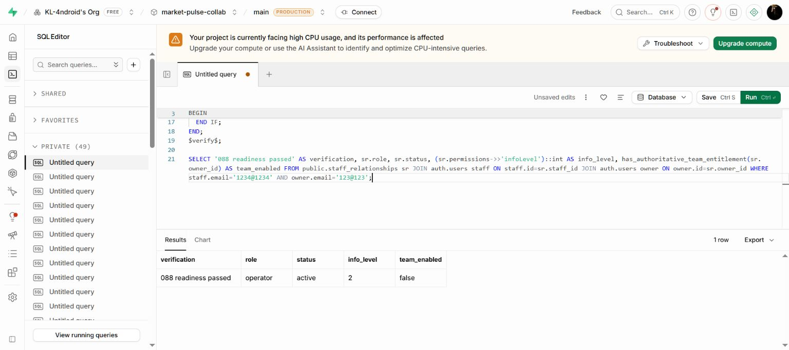

# 088 員工重新啟用保護

2026-10-28，Asia/Taipei。Sol 修補；雲端套用及唯讀檢查通過。

## 問題與既定規則

使用者確認：高階降級後保留員工關係，重新升級須由老闆逐一恢復。
原 064 只監聽 subscription_accounts；082 四小時測試覆寫是另一個有效方案
來源，原 active 員工可能隨 Team 覆寫重啟立即取得存取。訂閱純時間到期後
再更新續期，也可能沿用舊 active 狀態。

這兩種缺口均先以雲端實際函式在隔離 PostgreSQL 重現；沒有對正式資料庫
送出越權攻擊或建立正式訂閱。

## 最小修補

- [遷移](../../supabase/migrations/088_guard_staff_plan_reactivation.sql) 同時監聽
  subscription_accounts、subscription_write_guard_owners 的 INSERT／UPDATE／DELETE。
- 私有 helper 以 OLD 來源及另一個目前來源，按照 082 的測試覆寫優先序判斷
  更新前是否仍有 Team。更新前已失效，或更新後失效，均沿用既有暫停函式；
  角色／permissions／歷史事件保留，員工 market_members 按既有規則移除。
- 更新前後持續有效的 Team 不暫停；失效後重新啟用則保持 suspended_by_plan，
  老闆需以既有 restore_staff_relationship RPC 恢復個別成員。
- 來源 trigger 與恢復 RPC 使用同一 owner advisory transaction lock。restore
  原有登入、老闆、Team、suspended 狀態檢查、ACL 與 search_path 保留。
- 本輪沒有新增 browser／device 能力、付款、商店 adapter、排程或資料刪除。
  安裝與重跑遷移不回填既有員工。

## 驗證

```text
node scripts/verify-staff-plan-reactivation-sql.mjs --deployed
13 staff plan lifecycle checks passed (isolated database only).
```

[測試腳本](../../scripts/verify-staff-plan-reactivation-sql.mjs) 使用
[修補前雲端快照](../../tests/fixtures/staff-lifecycle-deployed-2026-10-28.json)
重現，再以 [修補後實際快照](../../tests/fixtures/staff-lifecycle-patched-deployed-2026-10-28.json)
核對 body、private helper ACL、restore ACL 及固定 search_path，載入後重跑：

| 類別 | 結果 |
| --- | --- |
| 覆寫由 Team 降級／清除、帳戶 Team 結束 | 暫停，保留角色及資料 |
| 已過期帳戶／覆寫重新續期 | 不自動恢復；老闆明確恢復才可使用 |
| 連續有效 Team 續期 | 不誤停用 |
| 過期覆寫仍有有效 Team 帳戶接續 | 不誤判中斷 |
| Free 覆寫原本遮蔽 Team，移除遮蔽 | 需要逐一恢復 |
| 非老闆、非 Team、已撤銷關係的恢復 | 拒絕 |
| 舊 role／permissions 矛盾 | 允許安全暫停，不替它升權 |
| 來源刪除、遷移重跑 | 不自動恢復、不批次回填 |

雲端 [唯讀驗證](../../supabase/verification/088_staff_plan_reactivation_readiness.sql)
通過，兩來源 trigger enabled、私有 helper 不可由 anon／authenticated／service_role
直接呼叫，restore 有共同 lock。另重跑事件／員工授權 12 組及訂閱寫入 8 組通過。

最後唯讀查詢指定測試關係仍為 operator／active／infoLevel 2，Team=false；
安裝沒有批次改動該關係。082 測試覆寫先前已關閉，沒有為本輪再升級測試帳號。



## 尚不能視為通過

- 純時間到期即時持久化 suspended 狀態：目前由動態 gate 先拒絕，下一次來源
  寫入時處理；未新增掃描排程，也未批次修整舊 active 關係。
- 真實商店到期、退款、續期、延遲通知與舊訂戶遷移；目前只有 admin／082
  test override。若新增 billing／promotion 來源，必須擴充 OLD 判斷。
- 多個真實資料庫連線的競態壓測、跨裝置角色快取完整驗收。
- 生產環境再次啟用 Team／恢復個別員工的完整端到端操作。本輪將限制行為
  放在隔離庫驗證，雲端只驗證部署定義／結構與現況。

SQL 已套用；本次依使用者要求將修補、測試與紀錄納入提交。推送及前端部署
狀態分別以 Git 歷程與部署結果確認，不由此文件推定。
